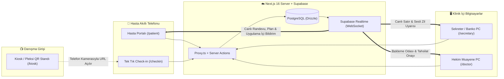
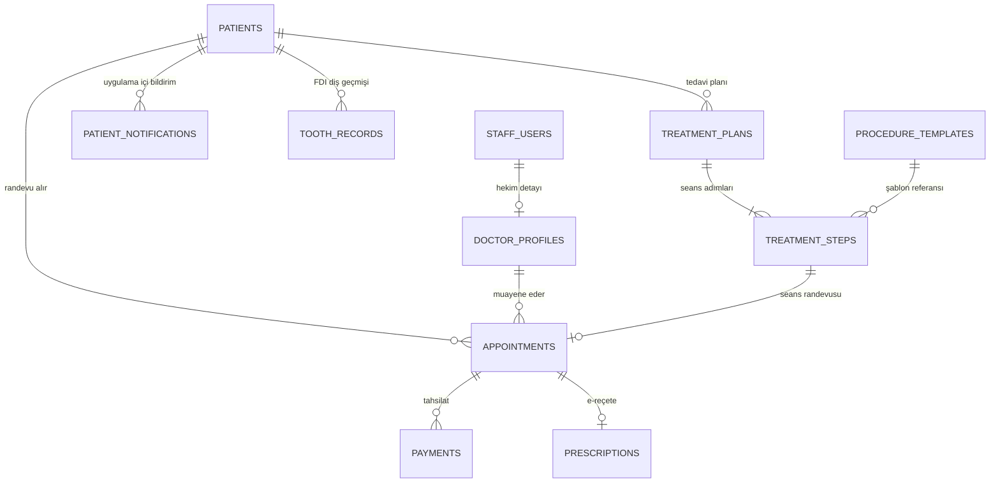

# 🏗️ DentaPanel — Teknik Mimari, Veritabanı ve Güvenlik Spesifikasyonu

Bu doküman, **DentaPanel** canlı ürününün (production) uçtan uca teknik mimarisini, veritabanı şemasını, gerçek zamanlı haberleşme yapısını ve ayrıştırılmış kimlik doğrulama kurgusunu tanımlar.

---

## 1. Teknoloji Yığını (Production Tech Stack)

| Katman | Teknoloji | Seçim Gerekçesi |
| :--- | :--- | :--- |
| **Uygulama Çatısı** | **Next.js 16.2 (App Router, Full-Stack SSR)** + **React 19** + **TypeScript 5** | Tek repoda hem mobil hasta web arayüzü hem masaüstü klinik panelleri hem de güvenli Server Actions / Route Handlers. *(Not: Statik `output: 'export'` kaldırılarak tam sunucu modunda çalışır; Next.js 16 kuralı gereği `middleware.ts` yerine `proxy.ts` kullanılır).* |
| **Veritabanı (DB)** | **Supabase PostgreSQL** | Ödeme, randevu ve tıbbi diş kayıtları için ACID garantili ilişkisel yapı, foreign key bütünlüğü ve hazır bulut yedekleme. Gerektiğinde standart PostgreSQL olduğu için hastane içi sunucuya (Docker/VPS) sıfır kod değişikliğiyle taşınabilir. |
| **ORM & Migration** | **Drizzle ORM (`drizzle-orm` + `postgres` + `drizzle-kit`)** | %100 TypeScript tip güvenliği, sıfır ek çalışma zamanı yükü ve versiyonlanabilir SQL migration dosyaları. |
| **Gerçek Zamanlı Katman** | **Supabase Realtime (`postgres_changes` / Broadcast)** | Banko bilgisayarı ödemeyi onayladığı veya hasta telefonundan QR check-in yaptığı anda, farklı ağ/cihazdaki **Hekim Bilgisayarı** ve **Banko Ekranı** arasında milisaniyelik WebSocket senkronizasyonu. |
| **Stil & UI** | **Tailwind CSS v4 + Lucide Icons** | Soft-minimalist dental tasarım token'ları (`@theme inline`), sıfır çalışma zamanı CSS maliyeti. |
| **Kimlik Doğrulama** | **Ayrıştırılmış Çift Oturum (`jose` JWT + `HttpOnly` Cookie + `bcryptjs`)** | Hasta (`Telefon + 4 Haneli PIN`) ile Klinik Personeli (`E-posta + Şifre`) oturumları çerez, tablo ve rota düzeyinde tamamen birbirinden izoledir. Sıfır SMS maliyeti ve sıfır operatör bürokrasisiyle canlıda güvenli çalışır. |
| **Bildirim Katmanı** | **Uygulama İçi Canlı Bildirimler (`notifications` + Supabase Realtime)** | Randevu onayları, saat değişiklikleri, tedavi planı ve e-reçete güncellemeleri uygulama içi canlı bildirim merkezi üzerinden anlık iletilir (SMS bağımlılığı yoktur). |
| **QR & Ses** | **`qrcode.react` + Doğrudan URL QR + Web Audio API** | Tarayıcı içi kamera izni gerektirmeyen doğrudan telefon kamerası link akışı (`/checkin`) ve hekim odası için sentetik sesli bildirim zili. |

---

## 2. Sistem Mimarisi ve Cihazlar Arası İletişim

---

## 3. Ayrıştırılmış Kimlik Doğrulama (Auth) Mimarisi — %100 SMS'siz

Sunum prototiplerinin aksine, canlı üründe **Hasta** ve **Personel** girişleri tamamen ayrı kapılardan ve ayrı oturum çerezleriyle (`cookie`) çalışır; hiçbir harici SMS operatörü/maliyeti gerektirmez:

### A. Hasta Girişi (`/giris` ve `/checkin`)
1. **Yöntem:** `Telefon Numarası (05XX...)` + `4 Haneli Kişisel PIN (veya Şifre)`.
2. **İlk Kayıt & PIN Kurtarma:**
   - Sistemde kaydı olmayan (veya banko tarafından PIN'siz açılmış) hasta numarasını yazdığında aynı ekranda `Ad`, `Soyad`, (opsiyonel) `TC Kimlik No` ve **kendi belirlediği 4 haneli PIN kodunu** girerek 5 saniyede kaydını tamamlar.
   - PIN veritabanında açık metin olarak değil, `bcrypt` hash (`pin_hash`) olarak saklanır; ardışık hatalı denemelere karşı rate-limit uygulanır.
   - **PIN Unutulursa:** Hasta kliniği aradığında veya danışmaya geldiğinde, Sekreter kendi ekranından **[🔑 Hasta PIN Sıfırla]** butonuna tıklar; hasta telefonundan girdiği anda yeni PIN belirler.
3. **Oturum (`dp_patient_session`):**
   - Doğrulama başarılı olduğunda `HttpOnly`, `Secure`, `SameSite=Lax` özellikli **30 gün geçerli** imzalı JWT çerezi tanımlanır.
   - **Kritik UX Avantajı:** Evde randevu alırken giriş yapmış olan hasta kliniğe gelip kamerasını danışmadaki QR koda tuttuğunda oturumu zaten açıktır; tekrar PIN bile girmeden tek bir **[Geldim — Check-in Yap]** butonuyla işlemini 2 saniyede tamamlar.

### B. Klinik Personeli Girişi (`/personel-giris`)
1. **Kapsam:** Yalnızca `secretary` (Banko/Sekreter), `doctor` (Diş Hekimi) ve `admin` (Klinik Yöneticisi) rolleri.
2. **Yöntem:** Kurumsal `E-posta (veya Kullanıcı Kodu)` + `Şifre` (`bcrypt` hash).
3. **Oturum (`dp_staff_session`):**
   - `HttpOnly`, `Secure`, `SameSite=Strict`, **12 saatlik (vardiya süreli)** imzalı oturum çerezi.
   - Giriş anında role göre otomatik yönlendirme yapılır:
     - `secretary` / `admin` $\rightarrow$ `/secretary/desk` (Canlı Banko Masası)
     - `doctor` $\rightarrow$ `/doctor/workspace` (Hekim Bekleme Odası & Muayene Ekranı)

### C. Rota ve Veri Erişim Koruması (`proxy.ts` + DAL)
- Next.js 16 `proxy.ts` katmanı tüm `/patient/*`, `/secretary/*`, `/doctor/*` ve `/kiosk/*` isteklerini karşılar; yetkisiz veya yanlış rollü istekleri ilgili giriş kapısına yönlendirir.
- Her Server Action içinde veri yazmadan önce `requirePatient()`, `requireSecretaryOrAdmin()` ve `requireDoctor()` fonksiyonları veritabanı seviyesinde yetkiyi doğrular.

---

## 4. Veritabanı Şeması (PostgreSQL / Drizzle ORM)

Para birimleri kuruş hassasiyetinde `integer` (veya `numeric(10, 2)`) olarak saklanır; tüm zaman damgaları `timestamptz` (`Europe/Istanbul` gösterimli) tipindedir.

### Tablo Tanımları

1. **`staff_users` (Klinik Personeli)**
   - `id` (uuid, PK), `full_name` (text), `email` (text, unique), `phone` (text), `password_hash` (text), `role` (`'admin' | 'secretary' | 'doctor'`), `is_active` (boolean), `created_at`.
2. **`doctor_profiles` (Hekim Ayarları & Muayene Ücreti)**
   - `id` (uuid, PK), `staff_user_id` (FK -> `staff_users.id`, unique), `title` (text: örn. "Dt.", "Uzm. Dt."), `branch` (text: örn. "Genel Diş", "Endodonti", "Çene Cerrahisi"), `initial_exam_fee` (numeric — hekime/branşa özel ön muayene ücreti), `default_slot_minutes` (int, varsayılan 30), `working_schedule` (jsonb — gün/saat aralıkları ve izinler).
3. **`patients` (Hastalar)**
   - `id` (uuid, PK), `phone` (text, unique — E.164 formatı `+905...`), `pin_hash` (text, nullable — `null` ise ilk girişte veya sekreter sıfırlaması sonrası yeni PIN belirletilir), `failed_pin_attempts` (int, default 0), `pin_locked_until` (timestamptz, nullable), `first_name` (text), `last_name` (text), `tc_identity_no` (varchar(11), nullable), `birth_date` (date, nullable), `medical_alert_note` (text, nullable — örn. penisilin alerjisi, kan sulandırıcı), `created_at`.
4. **`procedure_templates` (Hazır Diş İşlem & Fiyat Kataloğu)**
   - `id` (uuid, PK), `name` (text — örn. "Kompozit Dolgu", "Tek Kanal Tedavisi"), `category` (text), `default_price` (numeric), `default_duration_min` (int — örn. 30, 45, 60), `is_active` (boolean), `sort_order` (int).
5. **`appointments` (Randevular & Canlı Akış Durumu)**
   - `id` (uuid, PK), `patient_id` (FK), `doctor_id` (FK), `treatment_step_id` (FK, nullable — doluysa seans randevusu, boşsa ön muayene), `appointment_date` (date), `start_time` (time), `end_time` (time), `duration_min` (int),
   - `visit_type`: `'initial_exam' | 'treatment_session'`,
   - `status`:
     - `'pending_approval'` *(Ön Talep — Sekreter araması bekliyor)*
     - `'confirmed'` *(Onaylandı)*
     - `'checked_in_unpaid'` *(Geldi / QR Okuttu — Bankoda Ödeme Bekliyor)*
     - `'waiting_room'` *(Ödemesi Alındı — Hekim Bekleme Odasında)*
     - `'in_chair'` *(Muayenede / Koltukta)*
     - `'awaiting_chairside_payment'` *(Aynı Gün Koltukta Ek İşlem Yapıldı — Banko Tahsilat Kilidi)*
     - `'completed'` *(Tamamlandı)*
     - `'cancelled'` *(İptal — Sekreter kontrolünde)*
     - `'no_show'` *(Gelmedi)*
   - `is_early_arrival` (boolean — randevuya >30 dk erken geldiyse `true`, bekleme odasında bilgi etiketiyle görünür),
   - `checked_in_at` (timestamptz), `check_in_method` (`'qr' | 'manual'`), `complaint_text` (text), `created_by` (`'patient' | 'secretary'`), `created_at`, `updated_at`.
6. **`payments` (Kasa Tahsilat Hareketleri)**
   - `id` (uuid, PK), `appointment_id` (FK), `patient_id` (FK), `treatment_step_id` (FK, nullable), `payment_kind` (`'initial_exam' | 'session_prepay' | 'same_day_chairside'`), `expected_amount` (numeric), `collected_amount` (numeric), `method` (`'pos' | 'cash'`), `status` (`'pending' | 'collected' | 'cancelled'`), `approved_by_staff_id` (FK -> `staff_users.id`), `collected_at` (timestamptz), `note` (text).
7. **`tooth_records` (FDI 11–48 Metin Tabanlı Diş Kayıtları)**
   - `id` (uuid, PK), `patient_id` (FK), `appointment_id` (FK), `doctor_id` (FK), `fdi_number` (smallint — `11..18, 21..28, 31..38, 41..48` check constraint), `condition` (`'caries' | 'filling' | 'root_canal' | 'implant' | 'crown' | 'missing' | 'extraction_needed' | 'healthy'`), `clinical_note` (text), `created_at`.
8. **`treatment_plans` (Tedavi Planı Başlığı)**
   - `id` (uuid, PK), `patient_id` (FK), `doctor_id` (FK), `source_appointment_id` (FK), `status` (`'active' | 'completed' | 'cancelled'`), `doctor_summary_note` (text), `created_at`.
9. **`treatment_steps` (Tedavi Seans Adımları & Fiyatları)**
   - `id` (uuid, PK), `plan_id` (FK -> `treatment_plans.id`), `step_order` (int), `fdi_number` (smallint, nullable), `procedure_template_id` (FK, nullable), `title` (text), `price` (numeric — hekimin belirlediği net ücret), `duration_min` (int), `execution_mode` (`'scheduled_session' | 'same_day_chairside'`), `status` (`'planned' | 'scheduled' | 'awaiting_payment' | 'paid' | 'completed'`), `completed_at` (timestamptz).
10. **`prescriptions` (E-Reçete Yansıması)**
    - `id` (uuid, PK), `appointment_id` (FK), `patient_id` (FK), `doctor_id` (FK), `medula_eref_no` (text — hastanenin e-reçete protokol/referans kodu), `medications` (jsonb — ilaç adı, doz, kullanım tarifi dizisi), `note` (text), `created_at`.
11. **`patient_notifications` (Uygulama İçi Canlı Bildirimler)**
    - `id` (uuid, PK), `patient_id` (FK -> `patients.id`), `type` (`'appointment_confirmed' | 'appointment_updated' | 'plan_created' | 'prescription_ready' | 'session_scheduled'`), `title` (text), `body` (text), `is_read` (boolean, default `false`), `created_at` (timestamptz).

---

## 5. Kritik Saha Kuralları ve Edge-Case Çözümleri

1. **Ödeme Kapısı (Zero-Leakage Payment Gate):**
   - `checked_in_unpaid` durumundaki bir randevu için `payments` tablosuna `status = 'collected'` kaydı düşmeden randevu `waiting_room` statüsüne geçemez ve hekimin ekranında "Bekleme Odasında" zili çalmaz. İş kuralı yalnızca arayüzde değil, doğrudan Server Action ve DB transaction içinde zorunlu tutulur.
2. **Aynı Gün Koltukta Ek İşlem (Same-Day Chairside Procedure):**
   - Ön muayeneye gelen hasta koltuktayken hemen 1. seans işlemini yaptırmak isterse, hekim tedavi adımını `execution_mode = 'same_day_chairside'` olarak işaretler.
   - Bu anda Banko ekranına kırmızı öncelikli **`⚡ KOLTUKTA EK İŞLEM TAHSİLATI BEKLİYOR`** kartı ve sesli uyarı düşer; randevu `awaiting_chairside_payment` kilidine girer. Banko tahsilatı onaylamadan hasta çıkışı / randevu kapanışı (`completed`) yapılamaz.
3. **30 Dakikadan Erken Gelen Hasta:**
   - Randevusuna 30 dakikadan fazla süre varken gelen hastanın QR okutması **engellenmez**. Hasta bankoda ödemesini yapıp bekleme salonuna oturabilir; hekim ekranında `Erken Geldi (Randevu: 14:00)` etiketiyle normal sırasını bozmadan görünür.
4. **Doğrudan Telefon Kamerasıyla URL QR Check-in:**
   - Uygulama içi kamera izni (`getUserMedia`) kullanılmaz. Danışmadaki QR kod `https://<klinik-domain>/checkin?k=<gunluk_imzali_kod>` adresini açar. Hasta telefonunun kendi kamerasını tutar, açılan sayfada mevcut oturumuyla tek tıkla check-in yapar.
5. **Çift Kanallı Sonraki Seans Randevusu:**
   - Muayeneden çıkan hastanın planındaki 2. seans randevusunu ister **Sekreter bankodan direkt onaylı** olarak atar (seansın `duration_min` süresine uygun boş slota), ister hasta evinden **Ön Talep** olarak seçer.

