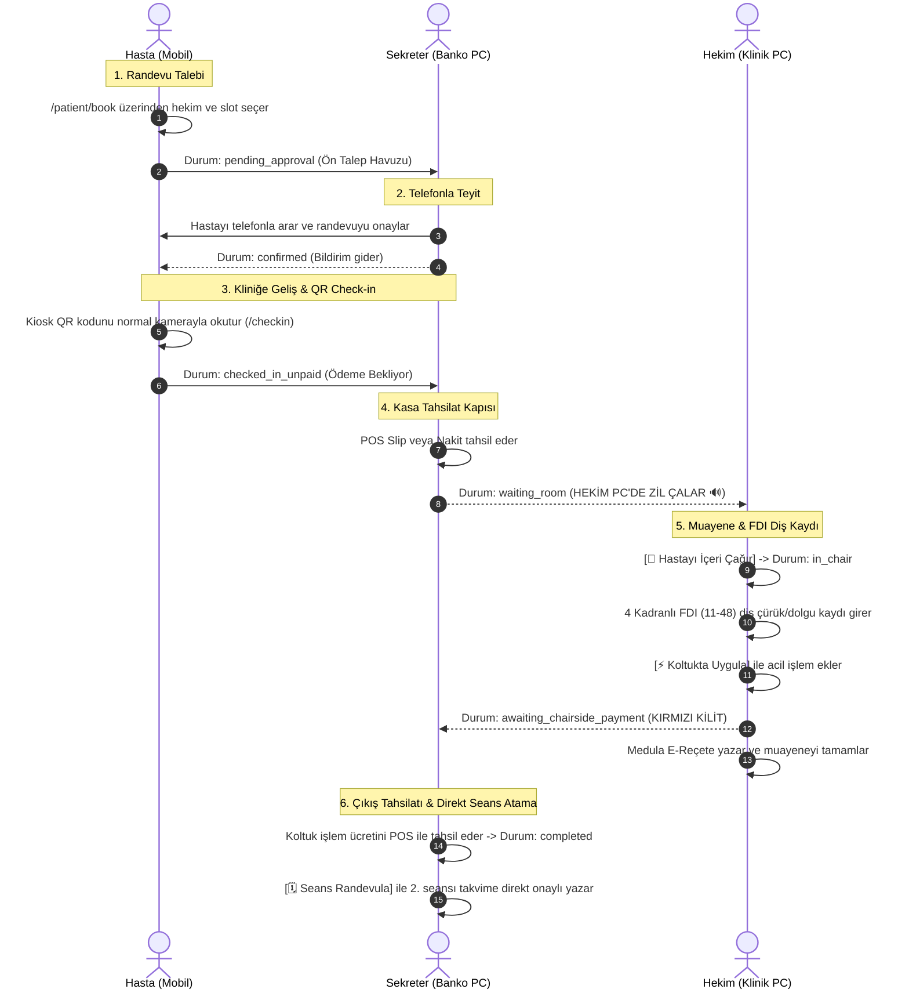
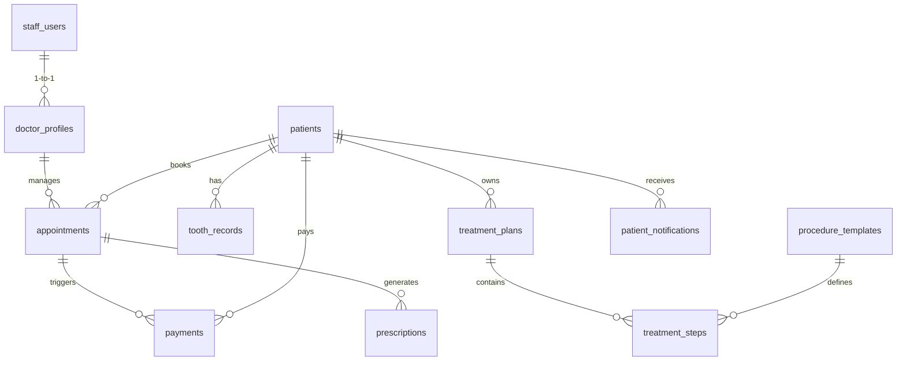

# 🦷 DentaPanel — Sistem Mimarisi, Kullanıcı Akışları (User Flow) & Kullanım Rehberi

DentaPanel; fiziksel diş kliniklerinin randevu, karşılama, kasa tahsilatı, hekim muayenesi ve tedavi seansı planlama süreçlerini tek bir çatı altında toplayan **canlı ürün (production)** mimarisidir.

Sistemde harici SMS sağlayıcısı bağımlılığı ve operatör evrak/maliyet yükü tamamen kaldırılmıştır. Vercel yerine bağımsız Docker/Node.js mimarisiyle, **Supabase PostgreSQL 17 + Drizzle ORM** veritabanı üzerinde çalışır.

---

## 👥 Sistemdeki 3 Temel Rol ve Giriş Kapıları

Sistem güvenliği için hasta ve klinik personeli girişleri birbirinden tamamen yalıtılmıştır:

| Rol | Ekran / Rota | Giriş Kimliği | Şifreleme / Oturum | Yönlendirme |
| :--- | :--- | :--- | :--- | :--- |
| **Hasta (Mobil Web)** | `/giris` | Telefon (`05XX...`) | 4 Haneli Kişisel PIN (`bcrypt` hash, 30 günlük `dp_patient_session` cookie) | `/patient` |
| **Danışma Kiosk** | `/kiosk` | Giriş gerekmez | Kurumsal karşılama tableti (Tam ekran dinamik QR kod) | Sabit Stand |
| **Sekreter / Banko** | `/personel-giris` | Kurumsal E-posta | Güçlü Şifre (12 saatlik `dp_staff_session` cookie) | `/secretary/desk` |
| **Diş Hekimi** | `/personel-giris` | Kurumsal E-posta | Güçlü Şifre (12 saatlik `dp_staff_session` cookie) | `/doctor/workspace` |

---

## ⚡ Kesinleşmiş 6 Kritik Saha Kuralı

1. **%100 SMS'siz Güvenlik:** Hasta ilk girişinde kendi 4 haneli PIN'ini belirler. Unutursa bankodaki sekreter **[🔑 PIN Sıfırla]** butonuyla tek tıkla sıfırlar. Tüm bildirimler uygulama içi canlı bildirim olarak (`patient_notifications`) akar.
2. **Sıfır Kaçak Ödeme Kapısı:** Muayene ücreti (POS Slip veya Nakit) banko ekranında tahsil edilmeden hasta asla hekimin bekleme odasına aktarılmaz.
3. **Doğrudan Telefon Kamerasıyla QR Check-in (`/checkin`):** Tarayıcı içinden kamera izni istenmez. Danışmadaki QR kod doğrudan `.../checkin` linkini açar; hasta normal telefon kamerasını tutar ve tek dev butonla check-in yapar.
4. **Erken Gelen Hasta (>30 dk) Desteği:** Randevu saatinden önce gelen hastanın check-in yapması engellenmez; ödemesini bankoda yapıp hekim ekranına `⏰ Erken Geldi` rozetiyle canlı olarak düşer.
5. **Aynı Gün Koltukta Ek İşlem Kilidi (`[⚡ Koltukta Uygula]`):** Muayene sırasında hasta anında bir dolgu veya işlem yaptırırsa, hekim adımı koltukta uygula olarak seçer. Banko ekranına anında **kırmızı acil çıkış tahsilatı kilidi** düşer; para alınmadan randevu kapatılamaz.
6. **Çıkışta Bankodan Direkt 2. Seans Randevusu Atama (Faz 4.4):** Muayeneden çıkan hastanın sonraki seansı (ör. *Kanal Dolumu - 45 dk*) sekreter tarafından doğrudan onaylı olarak takvime atanır; ön talep beklemez.

---

## 🎬 Adım Adım Uçtan Uca Kullanıcı Akışları (User Flows)



---

### Akış 1: Hastanın Evden Randevu Alması (`/patient/book`)
1. Hasta telefonundan kliniğin web adresine girer.
2. Telefon numarasını (`05XX XXX XX XX`) ve 4 haneli PIN kodunu girerek `/patient` portalına ulaşır.
3. **[+ Yeni Randevu Al]** butonuna tıklar:
   - **Adım 1:** Hekimini seçer (Unvan, branş ve taban muayene ücreti şeffaf olarak görünür).
   - **Adım 2:** Şikayetini yazar (*"Sol alt azı dişimde yemek yerken keskin bir sızı var"*).
   - **Adım 3:** Hekimin müsait olduğu tarih ve saat slotunu seçer.
4. Çift randevu kontrolünden (double-booking prevention) geçerek talep `pending_approval` statüsünde sisteme kaydedilir.

---

### Akış 2: Banko Ön Talep Teyidi & Onayı (`/secretary/requests`)
1. Bankodaki sekreterin ekranında **Ön Talep Havuzu** listelenir.
2. Sekreter hastayı telefonla arayarak teyit eder.
3. **[Talebi Onayla]** butonuna tıklar; randevu `confirmed` durumuna geçer ve hastanın telefonundaki canlı portala anında bildirim düşer.

---

### Akış 3: Danışma Tablet Kiosk & Cep Telefonu Kamerasıyla QR Check-in (`/kiosk` & `/checkin`)
1. Hasta kliniğin kapısından girer; danışma bankosundaki tablette büyük QR kod ve saat görünür (`/kiosk`).
2. Hasta telefonunun normal kamerasını tablete tutar.
3. Ekranda doğrudan `/checkin` sayfası açılır.
4. Sistem hastayı tanır; randevu saatini gösterir ve ortada tek bir dev buton çıkar: **[Geldim — Check-in Yap]**.
   - *30 Dakikadan Erken Gelen Hasta:* Engellenmez, `Erken Geldi` etiketi alır.
5. Butona basıldığı an randevu durumu `checked_in_unpaid` olur.

---

### Akış 4: Banko Kasa Masası & Tahsilat Kapısı (`/secretary/desk`)
1. QR okutan hasta, banko bilgisayarında **Ödeme Bekleyenler** masasının en üstüne turuncu parlamayla düşer.
2. Hasta bankoya yaklaşır. Sekreter POS cihazından slip çeker veya nakit alır.
3. Sekreter ekrandaki **[POS Slip Çekildi]** veya **[Nakit Tahsil Edildi]** butonuna basar:
   - Veritabanına anında `payments` kaydı açılır (Ciroya eklenir).
   - Randevu durumu `waiting_room` statüsüne geçer.
   - **Milisaniyeler içinde Hekimin Bilgisayarında Sesli Melodik Zil Çalar (`🔊 Web Audio Chime`).**

---

### Akış 5: Hekim Çalışma Alanı & Koltuğa Çağırma (`/doctor/workspace`)
1. Hekimin ekranındaki **Bekleme Odası (Canlı)** listesinde hastanın adı, şikayeti ve erken gelme durumu belirir.
2. Hekim kapıyı açıp ekrandaki **[🚪 Hastayı İçeri Çağır]** butonuna tıklar:
   - Randevu durumu `in_chair` (Koltukta) olur.
   - Hastanın telefonuna yönlendirme bildirimi gider.
   - Hekimin ekranı doğrudan muayene ve diş çizelgesi sayfasına yönlenir (`/doctor/examination/[id]`).

---

### Akış 6: 4 Kadranlı Hızlı FDI (11–48) Diş Haritası & Tedavi Planlama (`/doctor/examination/[id]`)
1. **FDI Diş Matrisi:** Üst çene (18-11 / 21-28) ve alt çene (48-41 / 31-38) tuşları yer alır.
2. Hekim ilgili dişe tıklar (ör. Diş #16):
   - Hızlı durum çiplerinden birini seçer: `🟢 Sağlam`, `🔴 Çürük`, `🔵 Dolgulu`, `🟠 Kanal Tedavili`, `🟣 İmplant`, `🔷 Kron`, `⚪ Eksik`, `🔻 Çekim`.
   - İsterse kısa klinik not yazar (*"Derin okluzal çürük, perküsyon +"*).
   - **[Diş Durumunu Kaydet]** butonuna basar; kayıt anında `tooth_records` tablosuna işlenir.
3. **Tedavi Planı & Seans Fiyatları:**
   - Hazır işlem şablonu dropdown'ından seçer (ör. *Kompozit Dolgu - 1.200 TL*).
   - İsterse fiyatı veya tahmini süreyi o hastaya özel değiştirir.
4. **`[⚡ Bugün Koltukta Uygula]` Kilidi (Aynı Gün İşlem):**
   - Hekim bu işlemi bugün hemen koltuktayken yaptıysa modu `⚡ Bugün Koltukta Uygulandı` olarak seçer.
   - Bu buton randevu durumunu `awaiting_chairside_payment` yapar ve bankoya kırmızı acil tahsilat emri gönderir.
5. **Medula E-Reçete:**
   - Hekim tek tıkla hazır reçete presetlerinden (Augmentin, Apranax, Klorhex vb.) ilaç ekler.
   - Medula E-Ref kodunu üretip kaydeder; hastanın portalına anında yansır.
6. **[Muayeneyi Tamamla]** butonuna basılır:
   - Koltukta ödenmemiş ek işlem varsa hekim uyarılır ve banko tahsilatı beklenir. Temizse randevu kapatılır.

---

### Akış 7: Çıkışta Koltuk Ek İşlem Tahsilatı & Direkt 2. Seans Atama (Faz 4.4)
1. Hasta muayeneden çıkıp bankoya gelir.
2. Banko ekranında randevu parlak **KIRMIZI** renkte **`⚡ Koltukta Ek İşlem Tahsilatı`** uyarısıyla kilitli durmaktadır.
3. Sekreter ek işlem bedelini tahsil eder; kilit kalkar ve randevu `completed` olur.
4. Sekreter aynı satırdaki **[🗓️ Seans Randevula]** butonuna basar:
   - Açılan modalda hastanın açık tedavi planındaki adımlar görünür (ör. *Seans 2: Kanal Tedavisi Dolumu - 45 dk*).
   - Sekreter hekim, tarih ve saat slotunu seçip **[Randevuyu Direkt Onayla]** butonuna basar.
   - Randevu **hiçbir ön talep beklemeden doğrudan `confirmed`** olarak hekimin takvimine yazılır ve hastaya bildirim gider.

---

## 🗄️ Veritabanı Mimarisi (11 Tablo)



1. `staff_users`: Sekreter, hekim ve yönetici personelleri.
2. `doctor_profiles`: Hekim unvanı, branşı, taban muayene ücreti ve çalışma saatleri.
3. `patients`: Hasta ad, soyad, telefon, TC kimlik, tıbbi alerji notu ve **4 haneli bcrypt PIN**.
4. `procedure_templates`: 13 adet hazır klinik işlem, kategori ve taban fiyat kataloğu.
5. `treatment_plans`: Hastaya ait aktif tedavi planı başlığı ve hekim özeti.
6. `treatment_steps`: Seans adımları, FDI diş numarası, seans fiyatı, tahmini süre ve uygulama modu (`scheduled_session` vs `same_day_chairside`).
7. `appointments`: Randevu tarihi, saati, süresi, erken geliş durumu ve canlı akış durumu (`pending_approval`, `confirmed`, `checked_in_unpaid`, `waiting_room`, `in_chair`, `awaiting_chairside_payment`, `completed`, `cancelled`).
8. `payments`: Kasa hareketleri, POS / Nakit yöntemi, türü (`initial_exam`, `session_prepay`, `same_day_chairside`), tahsilat tutarı ve onaylayan personel.
9. `tooth_records`: FDI 11–48 bazında metin/durum kayıtları ve klinik gözlem notları.
10. `prescriptions`: Medula E-Ref numarası, ilaç doz/kullanım JSON dizisi ve eczane notu.
11. `patient_notifications`: Hastanın cep telefonundaki portala düşen uygulama içi canlı bildirimler.

---

## 🚀 Çalıştırma, Test ve Yayına Alma Komutları

### 1. Geliştirme Modunda Başlatma
```bash
npm run dev
```
Uygulama `http://localhost:3000` adresinde açılır.

### 2. Canlı E2E Test Paketini Çalıştırma
```bash
node tests/run-all-tests.js
```
*Tüm sayfalar, butonlar, masaüstü ve mobil ekran görüntüleri taranarak uçtan uca doğrulanır.*

### 3. Üretim Derlemesi (Production Build)
```bash
npm run build
npm run start
```

### 4. Docker ile Bağımsız Dağıtım (Railway / VPS)
```bash
docker build -t dentapanel .
docker run -p 3000:3000 --env-file .env.local dentapanel
```

---

## 🔑 Test Giriş Bilgileri

| Rol | E-posta / Telefon | Şifre / PIN | Doğrudan Erişim |
| :--- | :--- | :--- | :--- |
| **Hasta 1 (Ahmet Yılmaz)** | `05551112233` | `1234` | `/giris` |
| **Hasta 2 (Ayşe Çelik)** | `05554445566` | `1234` | `/giris` |
| **Sekreter / Banko** | `sekreter@dentapanel.com` | `123456` | `/personel-giris` |
| **Dr. Dt. Zeynep Kaya (Protetik)** | `zeynep@dentapanel.com` | `123456` | `/personel-giris` |
| **Uzm. Dt. Mehmet Yılmaz (Çene Cerrahisi)** | `mehmet@dentapanel.com` | `123456` | `/personel-giris` |
| **Dt. Elif Demir (Genel Diş Hekimi)** | `elif@dentapanel.com` | `123456` | `/personel-giris` |

