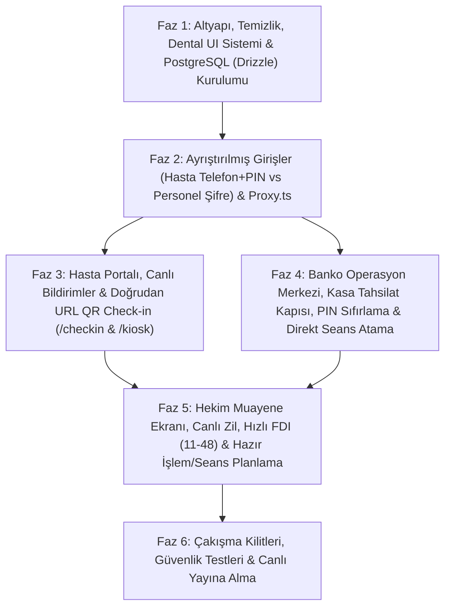

# 🚀 DentaPanel — Canlı Ürün (Production) Detaylı Uygulama Planı

Bu plan, **DentaPanel** projesinin sunum/prototip aşamasından çıkarılıp klinikte gerçek hastalar, banko bilgisayarı ve hekim muayene odası bilgisayarları arasında **canlı veritabanı, gerçek zamanlı bildirim ve ayrıştırılmış güvenlik** ile çalışacak **son ürün (production)** haline getirilmesi için hazırlanmıştır.

> **Referans Dokümanlar:**
> - Teknik Mimari & Veritabanı Şeması: [ARCHITECTURE.md](./ARCHITECTURE.md)
> - Dental Arayüz & Tasarım Kuralları: [DESİGN.md](./DESİGN.md)

---

## 📋 Kapsama Eklenen Kritik Saha Kararları (Kesinleşmiş Özeti)

1. **Gerçek Veritabanı & Canlı Senkronizasyon:** `LocalStorage` / `BroadcastChannel` yerine **Supabase PostgreSQL + Drizzle ORM + Supabase Realtime** kullanılır; Banko PC ile Hekim PC farklı bilgisayarlarda anlık haberleşir.
2. **%100 SMS'siz, Güvenli ve Ayrıştırılmış Giriş Kapıları (Prod Auth):**
   - **Hasta (`/giris` & `/checkin`):** Sıfır SMS maliyetiyle `Telefon Numarası + 4 Haneli Kişisel PIN` (`dp_patient_session` çerezi, 30 gün geçerli). İlk kayıtta hasta kendi 4 haneli PIN'ini belirler; unutursa bankodaki sekreter tek tıkla sıfırlar. Tüm bildirimler **Uygulama İçi Canlı Bildirim (`patient_notifications`)** olarak çalışır.
   - **Klinik Personeli (`/personel-giris`):** Sadece Sekreter, Hekim ve Yönetici için `E-posta + Şifre` (`dp_staff_session` çerezi, role göre otomatik panel yönlendirmesi).
   - Eski prototipteki "Rol Seçip Tıkla Gir" ana sayfası tamamen kaldırılır.
3. **Aynı Gün Koltukta Ek İşlem (Sorun 2 Çözümü):** Ön muayeneye oturan hasta koltuktayken hemen 1. seansı yaptırmak isterse, hekim adımı **`[Bugün Koltukta Uygula — Bankoya Tahsilat Gönder]`** olarak işaretler. Bankoda sesli/kırmızı acil tahsilat uyarısı yanar; tahsilat onaylanmadan randevu kapatılamaz (sıfır kaçak korunur).
4. **30 Dakikadan Erken Gelen Hasta (Sorun 3 Çözümü):** Erken gelen hastanın QR check-in yapması **engellenmez**. Ödemesini bankoda yapıp bekleme salonuna geçer; hekim ekranında `Erken Geldi (Randevu: 14:00)` etiketiyle listelenir.
5. **Doğrudan Telefon Kamerasıyla URL QR Check-in (Sorun 4 Çözümü):** Tarayıcı içinden kamera izni istenmez. Danışmadaki QR kod doğrudan `/checkin?k=...` linkini açar; hasta normal telefon kamerasını tutar ve açık oturumuyla **tek dev butonla** check-in yapar. Yaşlı/telefonsuz hastalar için Bankoda **[Manuel Geldi]** butonu bulunur.
6. **Eldiven Ergonomisi — Hazır İşlem & Fiyat Şablonları (Sorun 5 Çözümü):** Hekim muayene ekranında 4 kadranlı hızlı FDI tuş matrisi (`11–48`) ve tek tıkla eklenen hazır işlem/fiyat chip'leri (`procedure_templates`) kullanır; isterse fiyatı hastaya özel değiştirir.
7. **Bankodan Direkt Seans Randevusu Atama (Sorun 6 Çözümü):** Muayeneden çıkan hastaya 2. seans randevusunu ister Sekreter bankodan **direkt onaylı** olarak (işlem süresine göre, örn. 45/60 dk) verir, ister hasta telefonundan ön talep olarak seçer.

---

## 🗺️ Fazlara Bölünmüş Geliştirme Yol Haritası

---

### FAZ 1: Temel Altyapı, Eski Kod Temizliği, Dental UI & Veritabanı Şeması
**Hedef:** Projeyi statik tele-tıp prototipinden çıkarıp gerçek Next.js 16 sunucu mimarisine, Dental tasarım sistemine ve PostgreSQL veritabanına oturtmak.

- [ ] **1.1 Next.js 16 Sunucu Yapılandırması & Temizlik:**
  - `next.config.ts` içerisindeki `output: 'export'` kaldırılarak Server Actions, SSR ve `proxy.ts` aktif edilir.
  - Eski tele-tıp kalıntıları kaldırılır: `@google/generative-ai` AI rapor üretimi (`app/patient/book/actions.ts`), Zoom linkleri, dosya yükleme alanları, `app/admin/meta`, `app/admin/rooms` ve eski `mock-data.ts` bağımlılıkları temizlenir.
- [ ] **1.2 Dental Arayüz & Tasarım Token Güncellemesi (`DESİGN.md` Uyumu):**
  - `app/globals.css` içindeki `@theme inline` değişkenleri Dental Clinical palete (`#0f8a9d` primary, `#a8d5e5` secondary, `#eef3f6` steril buz grisi zemin, `#172130` ana metin ve semantik klinik durum renkleri) güncellenir; soft-minimalist köşe (`8px` / `16px-24px`) ve yumuşak renkli gölge kuralları korunur.
  - Mevcut `app/_components/ui/` bileşenlerindeki (`Card.tsx` vb.) bozuk CSS sınıfları (`nk-0`, `cate` vb.) onarılır; `Drawer` (sağdan açılan işlem çekmecesi) ve `Toast` bileşenleri eklenir.
- [ ] **1.3 Supabase PostgreSQL + Drizzle ORM Kurulumu:**
  - Paket kurulumları: `drizzle-orm`, `postgres`, `@supabase/supabase-js`, `jose`, `bcryptjs`, `qrcode.react`, `zod`.
  - `db/schema.ts` içinde [ARCHITECTURE.md](./ARCHITECTURE.md)'de tanımlanan 11 tablonun (`staff_users`, `doctor_profiles`, `patients`, `procedure_templates`, `appointments`, `payments`, `tooth_records`, `treatment_plans`, `treatment_steps`, `prescriptions`, `patient_notifications`) oluşturulması.
  - `drizzle.config.ts` migration kurulumu ve `db/seed.ts` ile başlangıç verilerinin (örnek yönetici/sekreter, 3 uzman diş hekimi, ön muayene ücretleri ve 15 hazır diş işlem şablonu) yüklenmesi.

---

### FAZ 2: Ayrıştırılmış Girişler (Hasta Telefon+PIN vs. Personel Auth) & Rota Koruması
**Hedef:** Hasta ve klinik personelinin sıfır SMS maliyetiyle, tamamen ayrı kapılardan ve güvenli oturumlarla sisteme girmesini sağlamak.

- [ ] **2.1 Hasta Kimlik Doğrulama — Telefon + 4 Haneli PIN (`/giris`):**
  - Telefon numarası kontrolü (`05XX XXX XX XX` -> `+905...`):
    - **Kayıtlı ve PIN'i olan hasta:** 4 kutucuklu otomatik odaklanan (`tabular-nums`) PIN ekranından `bcrypt` doğrulamasıyla giriş yapar (hatalı deneme kilidi korumalı).
    - **Yeni hasta (veya sekreterin PIN sıfırladığı hasta):** Aynı akışta `Ad`, `Soyad`, (opsiyonel) `TC Kimlik No` ve **kendi belirlediği 4 haneli PIN** ile kaydını tamamlar.
  - 30 gün geçerli `HttpOnly` `dp_patient_session` çerezi oluşturma.
- [ ] **2.2 Klinik Personeli Kimlik Doğrulama (`/personel-giris`):**
  - Hasta arayüzünden tamamen bağımsız kurumsal personel giriş sayfası (`E-posta + Şifre`).
  - `staff_users` doğrulaması, `dp_staff_session` çerezi ve role göre otomatik yönlendirme (`secretary`/`admin` $\rightarrow$ `/secretary/desk`, `doctor` $\rightarrow$ `/doctor/workspace`).
- [ ] **2.3 Next.js 16 `proxy.ts` & Server DAL Koruması:**
  - Kök dizinde `proxy.ts` oluşturularak `/patient/*`, `/secretary/*`, `/doctor/*`, `/kiosk/*` rotalarının oturum çerezlerine göre korunması; `/` ana dizininin oturum durumuna göre yönlendirilmesi.
  - `lib/auth/dal.ts` içinde `requirePatient()`, `requireSecretary()`, `requireDoctor()` sunucu doğrulayıcılarının yazılması.
- [ ] **2.4 Uygulama İçi Canlı Bildirim Servisi (`lib/notifications/`):**
  - Randevu onayı, saat revizyonu, tedavi planı ve e-reçete oluştuğunda `patient_notifications` tablosuna kayıt atan ve hasta portalında canlı okunmamış bildirim sayacı gösteren yardımcı servis.

---

### FAZ 3: Hasta Portalı, Randevu Ön Talebi & Doğrudan URL QR Check-in
**Hedef:** Hastanın mobil cihazından sıfır sürtünmeyle randevu isteyebilmesi, klinikte kendi kamerasıyla 2 saniyede check-in yapabilmesi ve planını/reçetesini takip etmesi.

- [ ] **3.1 Hasta Ana Ekranı, Canlı Durum Kartı & Bildirimler (`/patient`):**
  - Yaklaşan randevunun anlık durumunu gösteren ana kart (`Ön Talep İnceleniyor`, `Onaylandı`, `Ödeme Bekleniyor`, `Hekiminiz Sizi Bekliyor`).
  - Uygulama içi bildirim merkezi (Sekreter onayları, saat değişiklikleri, çıkan plan/reçete bildirimleri) ve iptal talebi.
- [ ] **3.2 Randevu Ön Talep Sihirbazı (`/patient/book`):**
  - Hekim kartları (Branş, unvan ve güncel **Ön Muayene Ücreti** net olarak görünür).
  - Yazılı şikayet giriş alanı (dosya/röntgen yükleme yok).
  - Seçilen hekimin `working_schedule` ve mevcut dolu randevularına göre gerçek boş slotların hesaplanması ve `status = 'pending_approval'` olarak kaydedilmesi.
- [ ] **3.3 Danışma Kiosk Ekranı (`/kiosk`) & Doğrudan URL Check-in (`/checkin`):**
  - `/kiosk`: Danışma tableti için tam ekran kurumsal karşılama + günlük HMAC imzalı `/checkin?k=...` URL'sini üreten büyük QR kod (veya sabit pleksi stand için kalıcı imzalı klinik kodu desteği).
  - `/checkin`: Hasta telefonunun normal kamerasıyla linki açtığında:
    - Oturumu açıksa bugünkü onaylı randevusunu bulur; tek bir büyük **[Geldim — Check-in Yap]** butonu gösterir.
    - Oturumu yoksa aynı ekranda hızlı Telefon + 4 Haneli PIN doğrulayıp otomatik check-in yapar.
  - **Erken Geliş Kuralı:** Randevuya >30 dk varsa engellemez; `is_early_arrival = true` işaretler ve hastaya bankoda ödemesi gereken Ön Muayene veya Seans ücretini gösterir (`status = 'checked_in_unpaid'`).
- [ ] **3.4 Tedavi Planı, Seans Ücretleri & E-Reçete Ekranları (`/patient/treatments`, `/patient/prescriptions`):**
  - Hekimin oluşturduğu seans adımlarını, net fiyatları ve ödeme/tamamlanma durumlarını listeleme.
  - Bekleyen seans adımı için **[Randevu Talep Et]** akışı (`treatment_step_id` bağlı ön talep).
  - Hastanenin e-reçete protokol/referans numarası ve ilaç kullanım tariflerini görüntüleme.

---

### FAZ 4: Banko / Sekreter Operasyon Merkezi, Kasa, PIN Sıfırlama & Direkt Seans Atama
**Hedef:** Bankonun tüm randevu onaylarını, fiziksel gelişleri, POS/nakit kasa tahsilatlarını, PIN sıfırlamayı ve çıkışta 2. seans randevularını tek ekrandan yönetmesi.

- [ ] **4.1 Canlı Banko Masası (`/secretary/desk`):**
  - Supabase Realtime aboneliği ile QR okutan hastaların sayfa yenilenmeden turuncu vurguyla **Ödeme Bekleyenler** listesinin en üstüne düşmesi.
  - **Koltukta Ek İşlem Kilidi:** Hekimin içeriden tetiklediği `awaiting_chairside_payment` durumundaki hastaların kırmızı **`⚡ Koltukta Ek İşlem Tahsilatı`** uyarısıyla sesli/görsel parlaması.
  - Telefonu olmayan/yaşlı hastalar için tek tıkla **[Manuel Geldi İşaretle]** ve PIN'ini unutan hastalar için **[🔑 Hasta PIN Sıfırla]** butonları.
- [ ] **4.2 Kasa Tahsilat Kapısı (`collectPaymentAction`):**
  - Ön muayene ücreti (hekimin `initial_exam_fee` tutarı), seans ücreti (`treatment_steps.price`) veya koltuk içi ek işlem tutarının gösterimi.
  - **[Fiziki POS ile Tahsil Edildi]** ve **[Nakit Tahsil Edildi]** onay butonları (DB Transaction ile hem `payments` kaydı açılır hem randevu `waiting_room` —veya çıkış kilidiyse `completed`— durumuna geçirilir).
- [ ] **4.3 Ön Talep Havuzu & Takvim Yönetimi (`/secretary/requests`, `/secretary/calendar`):**
  - Bekleyen ön talepleri telefonla görüşüp **Onayla**, **Tarih/Saat veya Hekim Değiştirerek Onayla** ya da **İptal Et** aksiyonları + uygulama içi bildirim kaydı.
- [ ] **4.4 Çıkışta Bankodan Direkt Seans Randevusu Atama:**
  - Muayeneden çıkan hastanın aktif tedavi planındaki bekleyen adımları görme ve adımın tahmini süresine (`duration_min`: 30/45/60 dk) göre hekim takviminden boş yer seçip **doğrudan `confirmed` (onaylı)** seans randevusu oluşturma.
- [ ] **4.5 Klinik Tanımları & Günlük Kasa Özeti (`/secretary/settings`, `/secretary/payments`):**
  - Hekim/personel yönetimi, branş/hekim bazlı ön muayene ücreti güncelleme, **Hazır İşlem & Fiyat Kataloğu (`procedure_templates`)** yönetimi ve günlük POS/Nakit tahsilat dökümü.

---

### FAZ 5: Hekim Muayene Paneli, Canlı Zil, Hızlı FDI (11–48) & Seans Planlama
**Hedef:** Hekimin bekleme odasını canlı takip etmesi, eldiven sonrası saniyeler içinde FDI diş kaydı ve seans/fiyat planı çıkarabilmesi.

- [ ] **5.1 Canlı Bekleme Odası & Web Audio Zil Sistemi (`/doctor/workspace`):**
  - Banko tahsilatı onayladığı anda Supabase Realtime ile düşen **"🔔 Hasta Bekleme Odasında"** bildirimi ve Web Audio API sesli klinik zili (üst barda tarayıcı Autoplay iznini açan tek tık `[🔊 Sesli Bildirim Aktif]` göstergesi).
  - Erken gelen hastalar için `Erken Geldi • Randevu 14:00` bilgi rozeti ve **[Hastayı İçeri Çağır]** (`status = 'in_chair'`) aksiyonu.
- [ ] **5.2 Grafiksiz 4 Kadranlı Hızlı FDI (11–48) Diş Kayıt Modülü (`/doctor/examination/[appointmentId]`):**
  - Görsel çizim olmadan 4 kadran tuş matrisi (`18–11 | 21–28` ve `48–41 | 31–38`), hızlı durum chip'leri (`Çürük`, `Dolgu`, `Kanal`, `İmplant`, `Kaplama`, `Eksik`, `Çekim`, `Sağlam`) ve kısa klinik not girişi.
  - Hastanın geçmiş tüm FDI diş kayıtlarının tarihçeli metin tablosu olarak aynı ekranda görünmesi.
- [ ] **5.3 Hazır Şablonlu Tedavi Planı, Fiyatlandırma & Aynı Gün İşlem Tetikleyici:**
  - `procedure_templates` listesinden tek tıkla seans adımı ekleme (işlem adı, süre ve varsayılan fiyat otomatik gelir; hekim fiyatı o hastaya özel serbestçe düzenler).
  - Her adım için uygulama modu seçimi:
    - **`[Sonraki Seansa Planla]`** $\rightarrow$ Hasta/Sekreter sonraki güne randevu alır.
    - **`[⚡ Bugün Koltukta Uygula]`** $\rightarrow$ Banko ekranına anında tahsilat emri düşürür ve randevuyu tahsilat kilidine alır.
- [ ] **5.4 E-Reçete Yansıtma & Muayene Tamamlama:**
  - Hastanenin kestiği Medula E-Reçete numarası (`medula_eref_no`) ve ilaç kullanım özetini kaydetme + hasta ekranına canlı bildirim düşürme.

---

### FAZ 6: Güvenlik Sıkılaştırma, Çakışma Kontrolleri & Canlı Yayına Hazırlık
**Hedef:** Eşzamanlı kullanımda veri tutarlılığını garanti altına almak ve sistemi gerçek klinik ortamında yayına hazır hale getirmek.

- [ ] **6.1 Veritabanı Kısıtları & Çakışma (Race Condition) Testleri:**
  - Aynı hekimin aynı tarih/saat aralığına çift aktif randevu yazılmasını engelleyen DB kontrolü.
  - Aynı randevu veya seans adımı için mükerrer tahsilat (`double-click` POS onayı) engeli (idempotency kontrolü).
- [ ] **6.2 Cihazlar Arası Canlı Kabul Testi:**
  - Gerçek iPhone (Safari) ve Android (Chrome) cihazlardan QR okutma -> Banko PC tahsilat -> Hekim PC sesli zil -> Aynı gün ek işlem ve 2. seans döngüsünün uçtan uca doğrulanması.
- [ ] **6.3 Prod Ortam Kurulumu & Dokümantasyon:**
  - `.env.example` (`DATABASE_URL`, `NEXT_PUBLIC_SUPABASE_URL`, `NEXT_PUBLIC_SUPABASE_ANON_KEY`, `SESSION_SECRET`, `KIOSK_HMAC_SECRET`) hazırlanması ve canlı sunucu kurulum adımları.

---

## 📌 Senin Tarafında Tamamlanması Gereken Hazırlıklar (Checklist)

- [ ] **Supabase Projesi:** Ücretsiz bir Supabase projesi oluşturup bağlantı bilgilerini (`DATABASE_URL`, `NEXT_PUBLIC_SUPABASE_URL`, `NEXT_PUBLIC_SUPABASE_ANON_KEY`) `.env.local` içine eklemek.
- [ ] **Klinik Başlangıç Verileri (Sonradan Panelden de Düzenlenebilir):**
  - Aktif hekimlerin ad-soyad, unvan, branş ve çalışma saatleri,
  - Hekim/branş bazlı güncel **Ön Muayene Ücretleri**,
  - **10–15 kalemlik Standart İşlem & Taban Fiyat Listesi** (Dolgu, Kanal, Çekim, Diş Taşı vb.).
- [ ] **Danışma QR Yerleşimi:** Bankoya tablet mi (`/kiosk`) konulacak, yoksa sabit pleksi QR standı mı bastırılacak? *(İkisi de desteklenir).*
